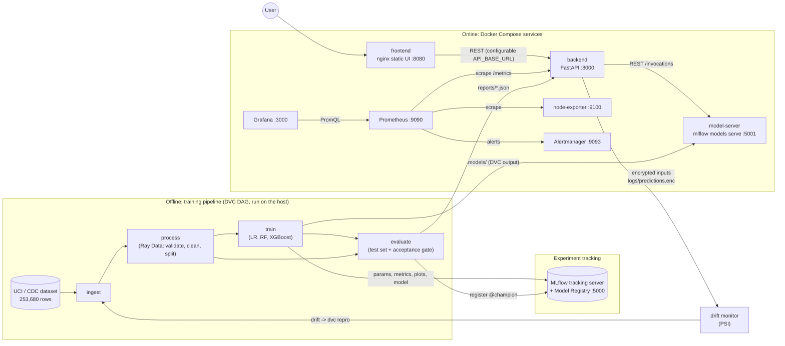

# Architecture

## Diagram

## Blocks

| Block | Technology | Responsibility |
|---|---|---|
| ingest | Python, ucimlrepo | Downloads the CDC Diabetes Health Indicators data (UCI id 891), checks the schema, writes `data/raw/diabetes.csv` and its MD5. |
| process | **Ray Data** | Splits the CSV into blocks processed in parallel: data-quality checks (nulls, ranges, non-integer codes, labels), quality gate, cleaning, stratified 70/15/15 split, drift reference distribution. Reports throughput. |
| train | scikit-learn, XGBoost, **MLflow** | Trains 6 candidates with class-imbalance handling, tunes the decision threshold for recall (F2), logs every run (params, metrics, plots, Git commit, data hash), selects the best by validation ROC-AUC, saves the model bundle and an MLflow pyfunc model. |
| evaluate | MLflow Model Registry | Scores the held-out test set, writes DVC metrics/plots, applies the acceptance gate, and registers the model as `diabetes-risk-model@champion` only if it passes. |
| DVC | **DVC** | Defines the DAG (`dvc.yaml`), caches data/models, re-runs only changed stages, versions metrics and plots. `scripts/ci.sh` is the CI gate. |
| MLflow tracking server | MLflow | Stores runs and artifacts (proxied; SQLite + artifact store in the `mlflow-data` Docker volume), hosts the Model Registry and the UI. Runs 2 workers so a restarted worker does not interrupt clients. |
| model-server | `mlflow models serve` | The inference engine: serves `models/mlflow_model` over REST. |
| backend | **FastAPI** | Validates input, calls the model server, explains the result (top changeable factors), logs inputs encrypted, computes live drift, exposes Prometheus metrics, serves pipeline status to the UI. |
| frontend | nginx, HTML/CSS/JS | Step-by-step risk questionnaire, result page, pipeline console, user manual. Knows the backend only through a configurable URL. |
| Prometheus / Alertmanager | Prometheus | Scrapes metrics every 5 s, evaluates 7 alert rules (backend down, model server down, error rate, latency, drift, pipeline failure, risk-share spike). |
| Grafana | Grafana | Provisioned dashboard (20 panels in 6 rows): service health, traffic, latency, errors, model outputs, drift per feature, pipeline stages, CPU/memory. Generated by `scripts/build_dashboard.py`. |
| drift monitor | Python (PSI) | Batch job that decrypts the 500 most recent inputs, compares them with the training distribution and triggers `dvc repro --force` on drift. |
| rollback | `scripts/rollback.sh` | Restores `models/` and the reports of an earlier commit from the DVC cache, moves `@champion` back in the registry and restarts the model server and backend. |

## Data flow of one prediction

1. The browser sends the 21 answers as JSON to `POST /api/v1/predict` on the backend.
2. The backend validates them (Pydantic). Invalid input returns 422 with the field names.
3. It builds the original row plus one "what-if" row per changeable risk factor and sends all rows in **one** request to the model server.
4. The model server runs the scikit-learn pipeline (feature engineering + classifier) and returns a risk score per row.
5. The backend derives the risk level from the tuned threshold, ranks the factors, records metrics, appends the encrypted input to the prediction log and returns the result.

Measured on the test VM (6 vCPUs): median 32 ms and p95 44 ms per prediction for one user; p95 232 ms with
4 concurrent users (HLD section 8.4).

## Deployment (Docker Compose)

| Service | Image | Port | Health check | Runs as |
|---|---|---|---|---|
| frontend | `diabetes-risk/frontend` (nginx) | 8080 | `/healthz` | nginx default |
| backend | `diabetes-risk/backend` (FastAPI) | 8000 | `/health` | non-root `appuser` |
| model-server | `diabetes-risk/mlflow` (`mlflow models serve`) | 5001 | `/ping` | root |
| mlflow | `diabetes-risk/mlflow` (`mlflow server`) | 5000 | `/health` | root |
| prometheus | `prom/prometheus:v2.53.0` | 9090 | - | nobody |
| alertmanager | `prom/alertmanager:v0.27.0` | 9093 | - | nobody |
| grafana | `grafana/grafana:11.1.0` | 3000 | - | grafana |
| node-exporter | `prom/node-exporter:v1.8.1` | 9100 | - | nobody |

The backend starts only after the model server is healthy (`depends_on: service_healthy`). Training runs
outside these services (`dvc repro` on the host, logging to the MLflow container) and hands over the model
through the DVC-tracked `models/` folder, which is mounted read-only into the model server and the backend.
